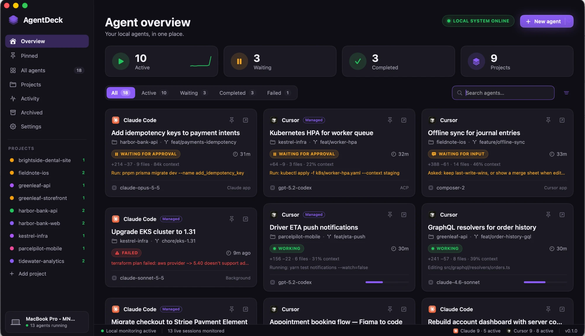
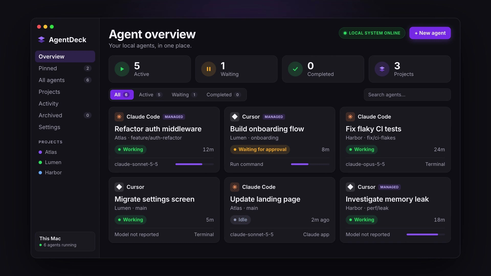

<h1 align="center">AgentDeck</h1>

<p align="center">
  <strong>A native macOS command centre for your local AI coding agents: Claude Code and Cursor.</strong><br>
  See every agent at a glance, know the moment one needs you, and jump straight to it.
</p>

<p align="center">
  <a href="https://github.com/ucaboro/agentdeck/actions/workflows/ci.yml"></a>
  
  
  
  <a href="LICENSE"></a>
</p>

<p align="center">
  
</p>

<p align="center">
  <a href="docs/video/agentdeck-brag.mp4"></a><br>
  <a href="docs/video/agentdeck-brag.mp4">▶ Watch the 23-second launch video</a><br>
  <sub>The video shows a recreation of the UI with made-up data. Music: "Happy Beats / Business Moves" by Sascha Ende (<a href="https://ende.app/en">ende.app</a>), CC BY 4.0.</sub>
</p>

---

## Why AgentDeck?

Running several coding agents at once means tabs everywhere: a Claude session in a terminal, two in the Claude app,
Cursor chats in three windows. You can't tell which one is waiting for your approval, which finished, and which failed
twenty minutes ago.

AgentDeck finds those sessions on your Mac and puts them on one dashboard. It uses the sign-ins you already have,
adds **no API keys and no API billing**, and keeps everything local.

## Features

- **One dashboard for Claude Code and Cursor.** Covers terminal sessions, background sessions, the Claude app's Code
  tab, Cursor app chats and Cursor CLI chats, grouped by project with branch, model and real usage numbers
  (`+214 −37 · 9 files · 84k context`).
- **Know when an agent needs you.** Shows *Waiting for approval*, *Waiting for input*, *Failed* and *Completed*, with
  macOS notifications and optional reminders when something has been waiting too long.
- **Jump straight to the agent.** Click a card to open that exact session in the Claude app, the exact chat in Cursor,
  or its terminal window.
- **Answer Cursor approvals without switching apps.** Accept or reject from AgentDeck or straight from the notification
  (needs the [AgentDeck Bridge](#agentdeck-bridge-cursor-extension)).
- **Start agents** in the Claude app, the Cursor app, as a managed background session, or in your terminal, with the
  exact command shown before anything runs.
- **Quick switcher.** Press <kbd>⌘K</kbd>, or <kbd>⌥⌘K</kbd> from any app, type a few letters and press Return.
- **Projects, pins and archive.** Git repos and worktrees are detected automatically. Pin what matters, drag to
  reorder, archive finished work by hand or automatically.
- **Activity log** with a daily summary of what your agents did.
- **Honest controls.** AgentDeck only offers actions it can really perform, never bypasses an approval prompt, never
  shows made-up progress, and never stops your agents when it quits.

## Requirements

- macOS 14 Sonoma or later
- Xcode 16+ (Swift 6 toolchain) to build from source
- At least one of:
  - [Claude Code](https://docs.claude.com/en/docs/claude-code) (CLI and/or the Claude desktop app), signed in
  - [Cursor](https://cursor.com) (the app and/or the `cursor-agent` CLI), signed in

## Installation

There are no pre-built releases yet. One script checks requirements, builds from source and installs to
`/Applications`:

```bash
git clone https://github.com/ucaboro/agentdeck.git
cd agentdeck
./scripts/install.sh                       # add --with-cursor-bridge if you use the Cursor app
```

It's safe to run again to update. Options, exit codes and uninstall steps are in [INSTALL.md](INSTALL.md).

### Install with an AI coding agent

Paste this into Claude Code, Cursor or another coding agent running on your Mac:

```text
Install AgentDeck on this Mac by following https://github.com/ucaboro/agentdeck/blob/main/INSTALL.md
("Instructions for AI coding agents"). Clone it to ~/agentdeck, run ./scripts/install.sh --check first,
then ./scripts/install.sh, and verify it's installed and running. Ask me before installing the Cursor
bridge or anything else not covered there. Don't change my Claude or Cursor settings, don't use sudo,
and tell me what each step did.
```

The agent follows [INSTALL.md](INSTALL.md), which spells out each step, how to check it worked, and what it must not do
without asking (edit your settings, sign in, use `sudo`, change the source).

## Getting started

1. **Open AgentDeck.** It starts finding sessions straight away. The first time it reads a project in a protected
   folder such as `~/Documents`, macOS asks for access. AgentDeck only reads git metadata there.
2. **Optional: turn on Claude Code hooks** in *Settings → Integrations → Claude Code*. This is what lets AgentDeck see
   when a Claude session is waiting for your approval or input. See [Claude Code hooks](#claude-code-hooks-optional).
3. **Optional: install the AgentDeck Bridge** in *Settings → Integrations → Cursor*. It lets AgentDeck open the exact
   Cursor chat, answer approvals and start chats in the Cursor app. Then run *Developer: Restart Extension Host* in
   Cursor.

### Keyboard shortcuts

| Shortcut | Action |
|---|---|
| <kbd>⌘N</kbd> | New agent |
| <kbd>⌘K</kbd> · <kbd>⌥⌘K</kbd> (any app) | Jump to an agent |
| <kbd>⌘F</kbd> | Search |
| <kbd>⌘1</kbd>–<kbd>⌘5</kbd> | Overview, Pinned, Projects, Activity, Archived |
| <kbd>⌘⇧A</kbd> · <kbd>⌘⇧W</kbd> | All agents · Needs attention |
| <kbd>⌘↩</kbd> | Open the selected agent where it runs |
| <kbd>⌘⇧P</kbd> · <kbd>⌘⌫</kbd> | Pin · Archive |
| <kbd>⌘.</kbd> · <kbd>⌘R</kbd> · <kbd>⌘⌥I</kbd> | Interrupt · Refresh · Toggle inspector |

## How it works

AgentDeck only uses what each tool exposes locally: documented CLIs, local session files and, for Cursor, an optional
extension. It never calls the Anthropic or Cursor APIs itself.

**Managed** agents were started by AgentDeck and can be controlled from it. **Monitored** agents were found on your
Mac and are observed; AgentDeck only shows the actions their provider really supports.

<details>
<summary><strong>Claude Code and Cursor CLIs</strong></summary>

| | Claude Code | Cursor |
|---|---|---|
| Discovery | `claude agents --json --all` (live interactive and background sessions); recent transcripts for resumable sessions | `~/.cursor/chats/<md5(cwd)>/<id>/meta.json` and the plain `meta` row of `store.db` (read-only; encrypted data never read); "running" inferred from `cursor-agent` processes |
| Launch (managed) | `claude --bg -n … [--model] [--permission-mode] [--worktree] <task>` | `cursor-agent acp`: `initialize` → `session/new` → `session/set_model` / `set_mode` → `session/prompt` |
| Launch (terminal) | `claude --session-id <uuid> …` in your terminal | `cursor-agent --workspace … <task>` in your terminal |
| Status | `busy` / `idle` and background `state`; waiting states via optional hooks | ACP `session/update` (messages, tool calls, plan progress), `stopReason` |
| Approvals | Answered in Claude Code; AgentDeck shows "Waiting for approval" | ACP `session/request_permission` relayed to the inspector |
| Stop / interrupt | `claude stop <id>` (background sessions) | `session/cancel` (ACP sessions) |
| Focus / resume | Activates the hosting app; `claude attach <id>`; `claude --resume <session>` | Opens the workspace in Cursor; `cursor-agent --resume <chat>` |
| Auth check | `claude auth status` (warns if not subscription sign-in) | `cursor-agent status` |

</details>

<details>
<summary><strong>Claude app and Cursor app</strong></summary>

| | Claude app (Code tab) | Cursor app |
|---|---|---|
| Discovery | `~/Library/Application Support/Claude/claude-code-sessions/…/local_*.json` maps Claude sessions to the app | `globalStorage/state.vscdb` (`composerHeaders`, `composerData:<id>`), read-only, fields extracted inside SQLite with `json_extract` |
| Running / waiting | From Claude Code (CLI listing and hooks) | Cursor doesn't save "running", so it's inferred from live message records: a tool call still `loading`, or a message in the last 90 s. An open question = waiting for input; `hasBlockingPendingActions` = waiting for approval |
| Open exact session | `claude://code/continue?session=local_<id>` | AgentDeck Bridge → `composer.openComposer` |
| Start new | `claude://code/new?folder=…&q=…` (opens prefilled; you press Enter) | AgentDeck Bridge → `composer.createNew`, prompt submitted |
| Approve / reject | In the app | AgentDeck Bridge → Cursor's own approval commands |

</details>

### AgentDeck Bridge (Cursor extension)

[`integrations/cursor-bridge`](integrations/cursor-bridge) is a small Cursor extension (about 130 lines, no network
access) handling `cursor://agentdeck.agentdeck-bridge/open|decide|new`:

- `decide` and `new` act on your behalf, so they need a random token stored with owner-only permissions at
  `~/Library/Application Support/AgentDeck/bridge-token`. A web page or another app that knows the link format can't
  use them.
- Cursor delivers links to the window you used last, so each link names its project folder. The bridge forwards it
  once to the right window.
- It logs what it receives (never the token or prompt text) to Cursor's *Output → AgentDeck Bridge* panel.

Install it from *Settings → Integrations → Cursor* (it ships inside AgentDeck.app) or with
`integrations/cursor-bridge/build.sh`.

### Claude Code hooks (optional)

*Settings → Integrations → Claude Code → Show when Claude is waiting for you* adds a relay command to
`~/.claude/settings.json`, after writing a timestamped backup. It covers SessionStart, UserPromptSubmit, Pre/PostToolUse,
PermissionRequest, Notification, Stop and SessionEnd. The relay only copies the hook payload into
`~/Library/Application Support/AgentDeck/hooks/spool` and always exits 0, so it can never approve or block anything.
Turning the switch off removes exactly those entries.

## Privacy and security

- **Local only.** No telemetry, no accounts, no cloud services. Data lives in
  `~/Library/Application Support/AgentDeck` with owner-only permissions.
- **Metadata only.** AgentDeck stores session titles, status, timestamps, folders and branches. It never stores
  credentials or conversation content.
- **No API billing.** AgentDeck removes `ANTHROPIC_API_KEY`, `ANTHROPIC_AUTH_TOKEN` and `CURSOR_API_KEY` from every
  process it starts, so a launch can't quietly switch to API billing.
- **Read-only access to other apps' data.** Cursor's and Claude's local files are opened read-only.
- **Nothing runs without you.** Every command AgentDeck runs is shown first, and approval prompts are never bypassed.

Found a security issue? See [SECURITY.md](SECURITY.md).

## Known limitations

- AgentDeck reads some **undocumented local formats** (Claude transcripts, Claude app session files, Cursor's state
  database). An update to either tool can change them. When a reader stops matching, Settings and the status bar show a
  warning instead of agents silently disappearing.
- A Cursor run's end is detected up to about 90 s late, because Cursor doesn't save "running".
- The Cursor bridge calls Cursor commands that aren't documented. If an update breaks them, opening a chat falls back
  to bringing the right window forward.
- Interactive Claude Code sessions belong to their terminal or the Claude app. AgentDeck can bring them forward but
  can't stop them. Background sessions (`claude --bg`) can be stopped.
- Agents started in AgentDeck via Cursor ACP are child processes and end when AgentDeck quits (you're asked first).
  Their chats stay resumable.

## Development

```bash
swift build                  # debug build
swift test                   # fixture tests for the provider formats AgentDeck reads
./scripts/build-app.sh       # release .app bundle in build/ (includes the Cursor bridge .vsix)
./scripts/install.sh         # build and install to /Applications
```

```text
Sources/AgentDeck/
  App/            SwiftUI app, menus and shortcuts, menu bar extra, notifications
  AgentCore/      Agent model, AgentAdapter protocol, AgentManager (registry, events, reminders, archive)
  Adapters/       Claude (CLI, transcripts, Claude app sessions, hooks) · Cursor (ACP, CLI chats, Cursor app chats)
  Process/        Async process runner, libproc inspection, terminal launcher, FSEvents watcher
  Persistence/    SQLite store for projects, agents, pins, events and settings
  Projects/       Git detection (including linked worktrees) and GitHub / GitLab / Bitbucket links
  DesignSystem/   Colour tokens (light and dark) and shared components
  Views/          Dashboard, cards, inspector, new agent, activity, projects, settings, quick switcher
Tests/            Fixture tests for Claude and Cursor formats, status rules, git links
integrations/     AgentDeck Bridge for Cursor
```

To add a provider, add a `ProviderKind` case and an `AgentAdapter` implementation; the UI doesn't change.

Useful flags: `AGENTDECK_DEBUG=1` prints refresh diagnostics; `--snapshot <png> [delay]` renders the main window to a
PNG; `--dev-launch <claude|cursor> <dir> <mode> <task>` exercises the managed launch path without the UI.

## Contributing

Contributions are welcome. Please read [CONTRIBUTING.md](CONTRIBUTING.md) and follow the
[Code of Conduct](CODE_OF_CONDUCT.md). Bug reports and feature requests go in
[Issues](https://github.com/ucaboro/agentdeck/issues).

## License

[MIT](LICENSE) © Anton Morozov

AgentDeck is an independent project and is not affiliated with or endorsed by Anthropic or Anysphere (Cursor).
Claude, Claude Code and Cursor are trademarks of their respective owners.
